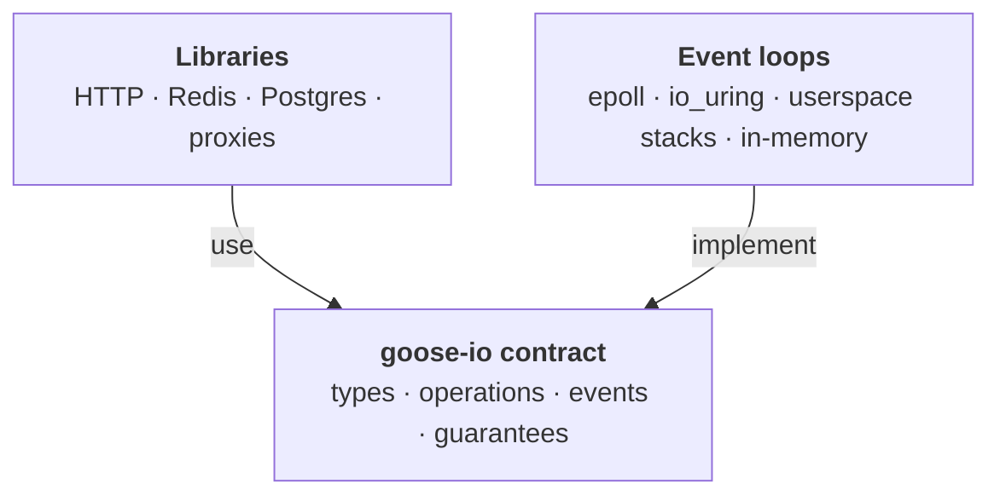
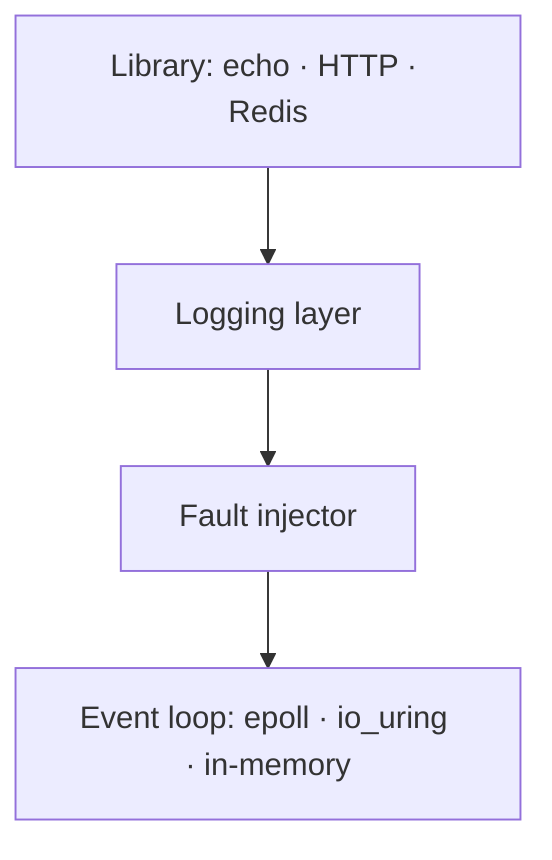

# goose-io

[](https://github.com/BHare1985/goose-io/actions/workflows/ci.yml)
[](https://github.com/BHare1985/goose-io/actions/workflows/ci.yml)
[](https://github.com/BHare1985/goose-io/actions/workflows/ci.yml)
[](https://github.com/BHare1985/goose-io/actions/workflows/ci.yml)

**A small, implementation-independent contract for stream I/O, between the libraries that speak protocols and the
event loops that move the bytes. Write a stream library once; run it on any event loop that meets the contract.**

An event loop drives connections and time. A library speaks a protocol on top of it: a Postgres client, a Redis client,
an HTTP server, a proxy. goose-io is the agreement between them: a small set of types, operations and events, with the
rules that make them mean the same everywhere. A library written against it does not know which event loop is
underneath, and an event loop does not know which libraries run on it. Independent implementations agree on how a
connection behaves without agreeing on how it is implemented.



| Layer | Responsibility |
|---|---|
| **Libraries** | Implement protocols and applications using only the contract. |
| **The contract** | Defines the operations, events, types and behavioural guarantees both sides rely on. |
| **Event loops** | Implement the contract with their own I/O mechanism: a poller, a completion ring, a userspace stack, or none at all. |

goose-io is **not** an event loop, a socket layer or a protocol library: there is no HTTP, SQL or Redis here, and no
operating-system sockets. It is the contract, a conformance suite that tells an event loop when it conforms, an
in-memory event loop for tests, and example libraries.

## Where it stands

| | Status |
|---|---|
| The contract, version 0.2 | Implemented: 12 operations and 5 events in the core, and six optional groups (half-close, sizing, abort, inspection, batching, unix) |
| The conformance suite | Implemented: the core and each group, with a fault for every check |
| The in-memory event loop | Implemented, for tests: scripted peers and a virtual clock |
| Example libraries | Implemented: echo, a line server, a pooled line client |
| An event loop on real sockets | **Not yet.** An epoll loop is planned as its own change (`openspec/changes/epoll-event-loop/`), then io_uring and uSockets |

So today a library runs on the in-memory loop (and over the test layers below), and runs on the real loops when they
land. Built and tested on linux-x64, macos-x64, macos-arm64 and windows-x64; the package is Goose source and builds no C.

## Choose your path

| | **I am writing a network library** | **I am writing an event loop** |
|---|---|---|
| You write | a state struct and one function that handles events | the 12 operations of the core, on top of your own I/O |
| You depend on | the contract | the contract |
| You get | code not tied to an event loop, and tests that need no network | every library written for the contract, and a suite that says when you are done |
| First example | [the echo server](#i-am-writing-a-network-library) | [a loop that supplies only the core](#i-am-writing-an-event-loop) |
| Guide | [docs/libraries.md](docs/libraries.md) | [docs/event-loops.md](docs/event-loops.md) |

Neither side needs the other's internals. Both are specified in [docs/contract.md](docs/contract.md).

## I am writing a network library

A library handles five core events (`Opened`, `Data`, `Writable`, `Closed`, `Tick`) and calls a handful of operations
(`send`, `close`, `dial`, `listen`, ...). That is its whole interface to the network: no sockets, descriptors, poll
masks or registered callbacks.

- **Portable.** The same source runs on every event loop that conforms.
- **Testable without a network.** A test runs your library on the in-memory event loop with scripted peers and a clock
  that moves only when nothing else can happen: the same events at the same times on every run, and a timeout test takes no
  time.
- **Honest about what it needs.** A library's header says what it uses (`Needs: core only`). On an event loop that
  lacks it, the library fails to compile and the error names the missing operation.

The smallest one is an echo server: every byte a peer sends comes back. The part that matters is below (the whole
library is [`examples/echo/echo.goose`](examples/echo/echo.goose)). It sends what arrived; if the event loop says `Full`
because the peer is not reading, it keeps the bytes, stops reading from that peer with `pause_reading`, and carries on
when the event loop says `Writable`, so a slow peer cannot make its memory grow without bound.

<!-- excerpt: examples/echo/echo.goose#on_data -->
```goose
fn _on_data<Io>(e: Echo&, io: Io&, c: Conn&, bytes: const u8[:]) {
    if c.held.len == 0 {
        let status = io.send(c.link, bytes);
        if status == goose_io::SendStatus.Sent { return; }
        if status != goose_io::SendStatus.Full { io.close(c.link); return; }
        e.refused++;
    }
    if c.held.len + bytes.len > HOLD { io.close(c.link); return; }
    c.held.append(bytes);
    io.pause_reading(c.link, true);
}
```

Run it on the in-memory loop, over a test layer that scrambles every byte in transit, and on a loop that supplies
nothing but the core:

```bash
goose run tests/examples/echo_test.goose
tests/examples/over_wrapper.sh
```

**Next:** [docs/libraries.md](docs/libraries.md) covers writing and testing a library. Bigger examples are in
`examples/`: a line server, a pooled line client, and `gateway.goose`, which runs both on one loop, neither knowing the
other exists.

## I am writing an event loop

An event loop drives the connections and the clock. If yours conforms, every library written for the contract runs on
it and you wrote none of them.

- **A bounded job.** The core is 12 operations and 5 events. The groups are optional: supply what you can, leave out what
  you cannot, and a library that needs a group you lack fails to build and names the missing operation.
- **You know when you are done.** The conformance suite checks the core and each group on its own, with both ends of
  every link on your loop. It is what makes interoperability testable, and it is how you earn a row in the table below.
- **Keep your design.** The contract exposes no file descriptor, socket address or poll mask. A loop with no
  operating-system sockets conforms, and so can a completion loop built on io_uring.

[`tests/support/core_only.goose`](tests/support/core_only.goose) shows the shape: it supplies the 12 operations of the core
and nothing else. It sits over the in-memory loop, so it is a scaffold for tests and not a real socket loop: copy its list
of operations and replace its calls to `inner` with your own I/O. The suite runs on it:

```bash
tests/conformance/run.sh --core-only           # the core of the suite, on a loop that supplies nothing else
tests/conformance/run.sh                       # the core and every group, on the in-memory loop
```

**Next:** [docs/event-loops.md](docs/event-loops.md) says what to supply, shows the program that runs the suite on your
loop, and how to read a failure. [docs/event-loops/](docs/event-loops/) maps candidate event loops (an epoll loop,
uSockets, io_uring, libuv, libevent) onto the contract.

## Event loops can be layered

An event loop does not have to sit directly on sockets: it can sit on another event loop and present the same contract
to the layer above. A library does not change when a layer is added.



The wrapper in `tests/support/wrapper.goose` is such a layer (it scrambles bytes and delays events, to show that a
library does not depend on timing it was not promised). Logging, metering, fault injection, and in time TLS fit the same
way. A layer is not an event loop of its own: it conforms by passing the suite over the loop beneath it.

| Event loop | Kind | Contract | Core | Groups |
|---|---|---|---|---|
| in-memory (`memory.goose`) | event loop, for tests | 0.2 | yes | half-close, sizing, abort, inspection, batching, unix |
| wrapper (`tests/support/wrapper.goose`) | a layer over another event loop | 0.2 | yes | half-close, sizing, abort, inspection, batching, unix |
| core only (`tests/support/core_only.goose`) | test scaffold | 0.2 | yes | none |

## Documentation

| Document | For | What it is |
|---|---|---|
| [docs/libraries.md](docs/libraries.md) | library authors | how to write a library and how to test it |
| [docs/event-loops.md](docs/event-loops.md) | event loop authors | how to write an event loop, run the suite, and which check proves which requirement; the candidate event loops and libraries |
| [docs/contract.md](docs/contract.md) | both | the contract operation by operation, with the rules, the states and the version |
| [docs/event-loops/](docs/event-loops/) | event loop authors | how each candidate event loop maps onto the contract |
| [bench/README.md](bench/README.md) | contributors | the benchmarks and their results |
| [docs/history.md](docs/history.md) | contributors | where this repository started |
| [CONTRIBUTING.md](CONTRIBUTING.md) | contributors | what to run before a change, how to add an event loop, and the repository layout |

What the contract does not cover (name resolution, TLS, UDP) is in `docs/contract.md`, "What the contract does not
cover".

## Try it

You need the Goose toolchain (v2026.4). From the root of this repository:

```bash
goose check goose_io.goose                      # the contract compiles
tests/run_tests.sh                              # unit tests, driver tests, example library tests
tests/conformance/run.sh                        # the conformance suite on the in-memory event loop
tests/conformance/run.sh --repeat 50            # fifty times: a check that fails once fails the run
tests/conformance/faults.sh                     # every check is shown to fail when the event loop is broken
```

## License

Apache-2.0. See [`LICENSE`](LICENSE). Contributions: see [`CONTRIBUTING.md`](CONTRIBUTING.md).
