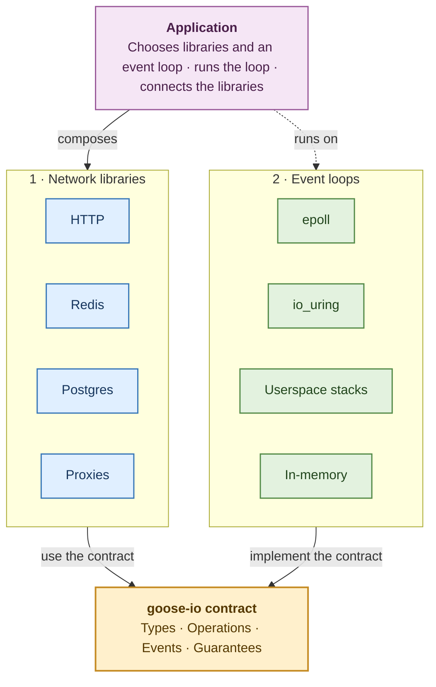
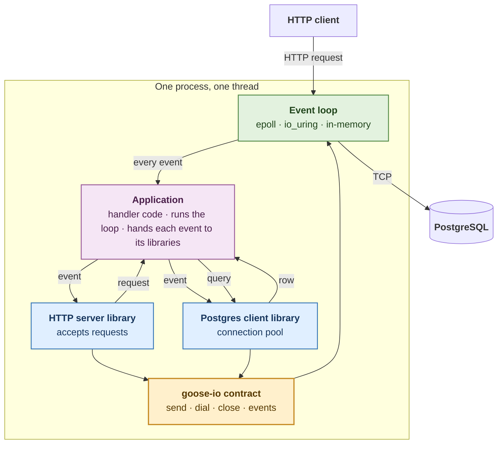
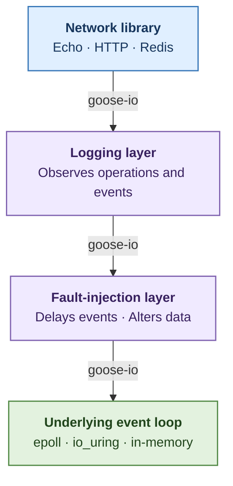

# goose-io

[](https://github.com/BHare1985/goose-io/actions/workflows/ci.yml)
[](https://github.com/BHare1985/goose-io/actions/workflows/ci.yml)
[](https://github.com/BHare1985/goose-io/actions/workflows/ci.yml)
[](https://github.com/BHare1985/goose-io/actions/workflows/ci.yml)

**Write a library or an event loop that works with every other library and event loop that uses goose-io.**

goose-io is a small, implementation-independent contract for stream I/O. A library that speaks a protocol (an HTTP
server, a Postgres client, a proxy) is written against it, and so is an event loop that drives the connections. Each side
is written once and is compatible with everyone on the other side, without either knowing how the other is implemented.

An **application** puts them together: it chooses libraries and an event loop, and connects the libraries to each other.
Application authors implement nothing of goose-io. They get the ecosystem: any library, on any event loop.

## Start here

| | **I am writing a library** | **I am writing an event loop** | **I am building an application** |
|---|---|---|---|
| Goal | A library that runs on every event loop that uses goose-io | An event loop that runs every library that uses goose-io | A program that combines libraries on an event loop |
| You write | A state struct and one function that handles events | The 12 operations of the core, on top of your own I/O | The glue: run the loop, hand each event to the libraries, connect them |
| You get | Portable code, and tests that need no network | Every library written for the contract, and a suite that says when you are done | Libraries and event loops from anyone, chosen independently |
| First example | [The echo server](#i-am-writing-a-library) | [A loop that supplies only the core](#i-am-writing-an-event-loop) | [Three lines](#i-am-building-an-application) |
| Guide | [docs/libraries.md](docs/libraries.md) | [docs/event-loops.md](docs/event-loops.md) | [docs/libraries.md](docs/libraries.md#the-application) |

No side needs another's internals. All three rely on [the same contract](docs/contract.md), which exposes no socket,
file descriptor or poll mask.

## How it fits together

An event loop drives connections and time. A library speaks a protocol on top of it. goose-io is the agreement between
them: a small set of types, operations and events, with the rules that make them mean the same everywhere. A library does
not know which event loop is underneath, and an event loop does not know which libraries run on it.



| Layer | Responsibility |
|---|---|
| **Application** | Chooses the libraries and the event loop, runs the loop, and connects the libraries to each other. It implements nothing of goose-io. |
| **Libraries** | Implement protocols using only the contract. |
| **The contract** | Defines the operations, events, types and behavioural guarantees both sides rely on. |
| **Event loops** | Implement the contract with their own I/O mechanism: a poller, a completion ring, a userspace stack, or none at all. |

goose-io is **not** an event loop, a socket layer or a protocol library: there is no HTTP, SQL or Redis here, and no
operating-system sockets. It is the contract, a conformance suite that tells an event loop when it conforms, an
in-memory event loop for tests, and example libraries.

## A common case: an HTTP server that calls Postgres

A request handler needs data from a database. Two problems follow.

1. **A library is tied to the server it was written for.** An HTTP server exposes connections and events through its
   own interfaces. A library written against them runs only on that server, and must be rewritten for each other.
2. **A client that avoids this usually carries its own I/O.** To work independently of any server, a Postgres client
   typically brings blocking sockets, threads or an event loop of its own, and in one process these must be reconciled
   with the server's loop: block its thread, hand work to a thread pool, or run and bridge a second loop. The
   alternatives are a client that exposes only a state machine for the caller to drive, which moves the I/O work onto
   every user, or one that polls file descriptors, which excludes loops that have none.

Neither can be tested without a real database and real time.

With goose-io both libraries are written against the contract and not against an event loop. A single event loop on one
thread drives both, and the **application** is the glue between them:



The application is ordinary code. It receives each event from the event loop and passes it to the libraries; each library
recognises its own links and ignores the rest. When the HTTP library hands over a request, the application's handler asks the
Postgres library for the row and, when the row arrives, gives it back as the reply. Neither library names the other, and
neither names the event loop.

- **Portable.** Each library runs on any conforming event loop, so neither is tied to a particular server or loop.
- **No second loop, no thread pool, no blocking.** The Postgres library dials or reuses a pooled link through the same
  loop, and each reply is an event that the application passes to the library that owns the link.
- **Bounded memory.** A send that does not fit returns `Full`, and `Writable` signals when to continue, so a slow
  client or a slow database cannot make either library's memory grow without bound.
- **Testable without a database.** Both libraries run on the in-memory event loop against a scripted Postgres peer
  and a virtual clock. A slow query, a reset connection or a refused dial is a few lines of test and takes no real time.

[`examples/gateway.goose`](examples/gateway.goose) has this structure with a line server in front and a pooled line
client behind it. HTTP and Postgres libraries are separate projects; this repository provides the contract they share.

## Where it stands

| | Status |
|---|---|
| The contract, version 0.3 | Implemented: the core and eleven optional groups (half-close, sizing, abort, inspection, batching, unix, relay, peek, revoke, wake, limits) |
| The conformance suite | Implemented: the core and each group, with a fault for every check |
| The in-memory event loop | Implemented, for tests: scripted peers and a virtual clock |
| Example libraries | Implemented: echo, a line server, a pooled line client |
| An event loop on real sockets | Event loops live in their own repositories (see [`examples/README.md`](examples/README.md)); io_uring and uSockets are mapped in `docs/event-loops/` |
| A worked library | A TCP router that runs on any loop with the groups it needs (see [`examples/README.md`](examples/README.md)) |

So today a library runs on the in-memory loop (and over the test layers below), and on the real loops that live in their own
repositories. Built and tested on linux-x64, macos-x64, macos-arm64 and windows-x64; the package is Goose source and builds no C.

## I am writing a library

A library handles five core events (`Opened`, `Data`, `Writable`, `Closed`, `Tick`) and calls a handful of operations
(`send`, `close`, `dial`, `listen`, ...). That is its whole interface to the network: no sockets, descriptors, poll
masks or registered callbacks.

- **Portable.** The same source runs on every event loop that conforms.
- **Testable without a network.** A test runs your library on the in-memory event loop with scripted peers and a clock
  that moves only when nothing else can happen: the same events at the same times on every run, and a timeout test takes no
  time.
- **Honest about what it needs.** A library's header says what it uses (`Needs: core only`). On an event loop that
  lacks it, the library fails to compile and the error names the missing operation.

The smallest one is an echo server: every byte a peer sends comes back. The part that matters is below (the whole
library is [`examples/echo/echo.goose`](examples/echo/echo.goose)). It sends what arrived; if the event loop says `Full`
because the peer is not reading, it keeps the bytes, stops reading from that peer with `pause_reading`, and carries on
when the event loop says `Writable`, so a slow peer cannot make its memory grow without bound.

<!-- excerpt: examples/echo/echo.goose#on_data -->
```goose
fn _on_data<Io>(e: Echo&, io: Io&, c: Conn&, bytes: const u8[:]) {
    if c.held.len == 0 {
        let status = io.send(c.link, bytes);
        if status == goose_io::SendStatus.Sent { return; }
        if status != goose_io::SendStatus.Full { io.close(c.link); return; }
        e.refused++;
    }
    if c.held.len + bytes.len > HOLD { io.close(c.link); return; }
    c.held.append(bytes);
    io.pause_reading(c.link, true);
}
```

Run it on the in-memory loop, over a test layer that scrambles every byte in transit, and on a loop that supplies
nothing but the core:

```bash
goose run tests/examples/echo_test.goose
tests/examples/over_wrapper.sh
```

**Next:** [docs/libraries.md](docs/libraries.md) covers writing and testing a library. Bigger examples are in
`examples/`: a line server, a pooled line client, and `gateway.goose`, which runs both on one loop, neither knowing the
other exists.

## I am building an application

An application chooses libraries and an event loop, and runs the loop. With one library it is three lines. This is the
echo server, on the in-memory event loop:

```goose
var io = goose_io_memory::Loop { .. };               // the event loop: any one that uses goose-io
var echo = echo::Echo { .. };                        // the library
echo.start(io, "0.0.0.0:7");                         // the library listens on port 7
io.serve() { io, ev => echo.echo_event(io, ev); };   // run the loop; give every event to the library
```

To use another event loop, change the first line.

With two libraries, the application offers each event to the libraries in turn:

```goose
io.serve() { io, ev =>
    if !server.server_event(io, ev) {   // offered to the server; it returns false if the link is not its own
        client.client_event(io, ev);    // so the client is offered it next
    }
};
```

A library is **offered** an event but only **handles** the events of links it owns. The contract requires a library to
return `false`, and to do nothing else, for an event about a link that it did not dial or accept itself. So the first
library in the chain is offered every event and ignores the ones that are not its own, and a library never reads or changes
another library's connection. A `Tick` is not about any link, so every library in turn is offered it.

**Two ways to dispatch.** Offering each event in turn, as above, is the simplest: the application holds no state, and each
library before the owner does a failed ownership check per event (a table lookup, a few nanoseconds), so the cost grows with
the number of libraries. [`examples/dispatch.goose`](examples/dispatch.goose) instead keeps which library owns each link and
makes one lookup per event whatever the number of libraries. That costs a table in the application and a drop in `Closed`, and
the first event of each link is still offered in turn until a library claims it. The comparison is in
[docs/libraries.md](docs/libraries.md#offering-in-turn-or-dispatching-by-link).

Connecting the libraries to each other, such as turning a request the server received into a query by the client, is
ordinary code in the same handler. [`examples/gateway.goose`](examples/gateway.goose) does this with a line server and a
pooled line client, and [the application section of docs/libraries.md](docs/libraries.md#the-application) explains it.
Application authors implement nothing of goose-io: they choose libraries and an event loop written by anyone else.

## I am writing an event loop

An event loop drives the connections and the clock. If yours conforms, every library written for the contract runs on
it and you wrote none of them.

- **A bounded job.** The core is 12 operations and 5 events. The groups are optional: supply what you can, leave out what
  you cannot, and a library that needs a group you lack fails to build and names the missing operation.
- **You know when you are done.** The conformance suite checks the core and each group on its own, with both ends of
  every link on your loop. It is what makes interoperability testable, and it is how you earn a row in the table below.
- **Keep your design.** The contract exposes no file descriptor, socket address or poll mask. A loop with no
  operating-system sockets conforms, and so can a completion loop built on io_uring.

[`tests/support/core_only.goose`](tests/support/core_only.goose) shows the shape: it supplies the 12 operations of the core
and nothing else. It sits over the in-memory loop, so it is a scaffold for tests and not a real socket loop: copy its list
of operations and replace its calls to `inner` with your own I/O. The suite runs on it:

```bash
tests/conformance/run.sh --core-only           # the core of the suite, on a loop that supplies nothing else
tests/conformance/run.sh                       # the core and every group, on the in-memory loop
```

**Next:** [docs/event-loops.md](docs/event-loops.md) says what to supply, shows the program that runs the suite on your
loop, and how to read a failure. [docs/event-loops/](docs/event-loops/) maps candidate event loops (an epoll loop,
uSockets, io_uring, libuv, libevent) onto the contract.

## Event loops can be layered

An event loop does not have to sit directly on sockets: it can sit on another event loop and present the same contract
to the layer above. A layer is a library of the event loop beneath it and an event loop to the layer above, and a library does not change when a layer is added.



The wrapper in `tests/support/wrapper.goose` is such a layer (it scrambles bytes and delays events, to show that a
library does not depend on timing it was not promised). Logging, metering, fault injection, and in time TLS fit the same
way. A layer is not an event loop of its own: it conforms by passing the suite over the loop beneath it.

| Event loop | Kind | Contract | Core | Groups |
|---|---|---|---|---|
| in-memory (`memory.goose`) | event loop, for tests | 0.3 | yes | half-close, sizing, abort, inspection, batching, unix, relay, peek, revoke, wake, limits |
| wrapper (`tests/support/wrapper.goose`) | a layer over another event loop | 0.2 | yes | half-close, sizing, abort, inspection, batching, unix |
| core only (`tests/support/core_only.goose`) | test scaffold | 0.2 | yes | none |

## Documentation

| Document | For | What it is |
|---|---|---|
| [docs/libraries.md](docs/libraries.md) | library authors | how to write a library and how to test it |
| [docs/event-loops.md](docs/event-loops.md) | event loop authors | how to write an event loop, run the suite, and which check proves which requirement; the candidate event loops and libraries |
| [docs/contract.md](docs/contract.md) | both | the contract operation by operation, with the rules, the states and the version |
| [docs/event-loops/](docs/event-loops/) | event loop authors | how each candidate event loop maps onto the contract |
| [bench/README.md](bench/README.md) | contributors | the benchmarks and their results |
| [docs/history.md](docs/history.md) | contributors | where this repository started |
| [CONTRIBUTING.md](CONTRIBUTING.md) | contributors | what to run before a change, how to add an event loop, and the repository layout |

What the contract does not cover (name resolution, TLS, UDP) is in `docs/contract.md`, "What the contract does not
cover".

## Try it

You need the Goose toolchain (v2026.4). From the root of this repository:

```bash
goose check goose_io.goose                      # the contract compiles
tests/run_tests.sh                              # unit tests, driver tests, example library tests
tests/conformance/run.sh                        # the conformance suite on the in-memory event loop
tests/conformance/run.sh --repeat 50            # fifty times: a check that fails once fails the run
tests/conformance/faults.sh                     # every check is shown to fail when the event loop is broken
```

## License

Apache-2.0. See [`LICENSE`](LICENSE). Contributions: see [`CONTRIBUTING.md`](CONTRIBUTING.md).
